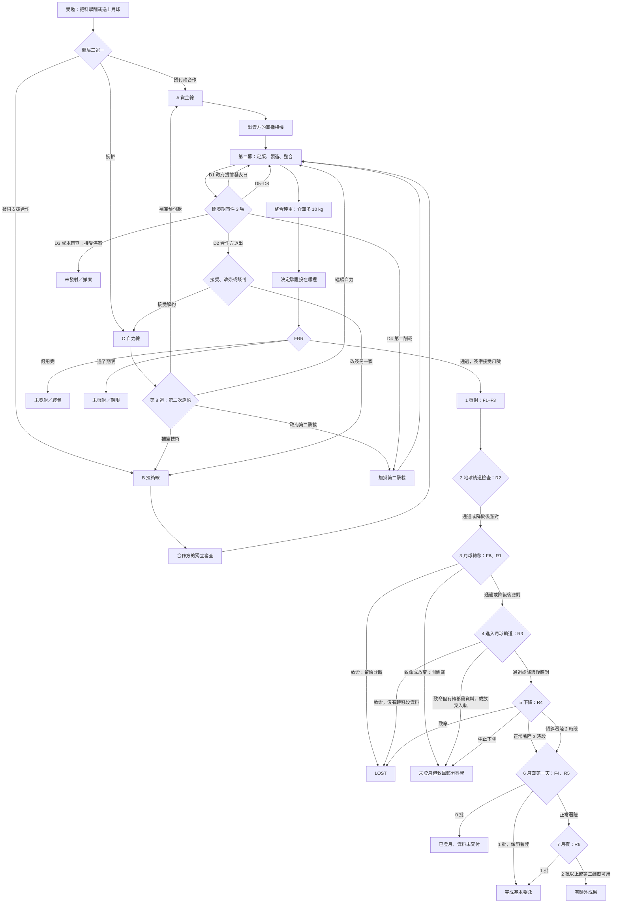

# 困難／登月計畫

團隊受邀將無人科學酬載送上月球。最低要求是酬載成功抵達月面，並回傳一批可用的資料。政府想把發表日提前，合作方各自帶著條件，飛行中的每一段都可能出狀況。這一章要玩家決定驗證投在哪裡，再帶著沒驗證的項目飛。

這份文件是第二版的故事架構。真實任務事件表在 [`lunar-history.md`](lunar-history.md)，文中用 H01–H32 引用。

章節以 [`lunar-rules.ts`](../../src/missions/lunar-rules.ts) 接入工作台，並以 [`lunar-mission.ts`](../../src/missions/lunar-mission.ts) 的模擬器判定飛行。[固定種子測試](../../tests/lunar-mission.test.ts)包含正式引擎策略和平衡回歸。現行流程與偏離原提案的項目見[登月故事審查 §9](../story-lunar.md#9-改版處理狀態)。

文中的質量、經費、週數和門檻都是**遊戲設定**。工程因果對照 NASA 來源，連結附在各節和來源對照表。

## 三幕與時間預算

首次遊玩目標約 30 分鐘。估算以每個決策畫面 30–75 秒計，尚未實測。

| 幕 | 內容 | 決策數 | 時間 |
| --- | --- | ---: | ---: |
| 第一幕　受邀 | 任務簡報、三選一的合作、取捨研究、架構和初步設計。到 PDR 為止。 | 約 6 | 6 分鐘 |
| 第二幕　交期 | 定版、製造、整合。三張開發期事件、一個故事線事件、介面質量問題、決定驗證投在哪裡、測出問題之後怎麼辦、送 FRR。 | 約 22 | 12 分鐘 |
| 第三幕　飛行 | 七步模擬。兩張飛行期事件，每個風險項目在自己的步驟揭曉，出問題時選應對。 | 約 10 | 9 分鐘 |
| 結算 | 任務成果、收尾文字、已接受的風險、任務檔案回顧。 | — | 3 分鐘 |

多週工作是一次操作。第二幕的 22 個決策約等於 12 次排工、5 次驗證取捨、4 次事件和 1 次送審。

## 任務與資源

| 項目 | 數值（遊戲設定） |
| --- | --- |
| 初始期限 | 26 週。期限當週的工作完成後仍可送 FRR。 |
| 初始經費 | 150 |
| 最低要求 | 登上月面，地面收到 1 批可用資料。 |
| 額外目標 | 地面收到 2 批以上，或完成基本委託並讓政府的第二酬載可用。 |
| 發射質量配額 | 起飛時含推進劑共 500 kg。 |
| 推進劑保留量 | FRR 要求餘裕 ≥ 10 kg。 |

期限從 20 週改成 26 週。多出的 6 週留給選做的驗證工作，每升一級 1 週。經費沒有跟著增加，所以時間夠做的驗證，錢不一定夠。

任務簡報把需求分給四個區段：發射、太空、地面、使用者。MDR 確認每項需求都有負責的組別。 [Design and Develop Science Missions 第 8、19 頁](https://www.nasa.gov/wp-content/uploads/2025/04/250323-design-and-develop-science-mission.pdf#page=8)

組別有四個：科學組、飛行系統組、軌道與導航組、地面與通訊組。 [Mission Design Lab](https://etd.gsfc.nasa.gov/capabilities/integrated-design-center/mission-design-lab/)

## 三條故事線

三條線從開局的選擇長出來。每條線有自己的中段事件。中途有四個轉線節點。

| 故事線 | 開局 | 資源特徵 | 中段事件 | 這條線的問題 |
| --- | --- | --- | --- | --- |
| A　資金線 | 預付款合作案 | 錢最多，合約工作 2 週。 | 出資方想在登陸器上裝直播相機。 | 錢約夠 8–9 級驗證。額外目標和驗證搶同一筆錢。 |
| B　技術線 | 技術支援合作案 | 3 個支援時段，合約工作 3 週。經費最緊。 | 合作方的獨立審查點出最弱的一項。 | 時段要換硬體、換工期，還是換驗證。 |
| C　自力線 | 婉拒 | 工期最寬，錢只夠 1–2 級驗證。 | 第 8 週的第二次邀約。 | 帶著大半沒驗證的項目飛，或中途轉線。 |

### 開局合約

只能有一份有效合約。合約工作每週占用一個主工作回合，不花經費。邀約保留到 PDR 通過前。合約要在送 FRR 前交件或終止。

| 選擇 | 合約工作 | 回報與取得時點 |
| --- | ---: | --- |
| 預付款合作案 | 2 週 | 簽約時 +40 經費。交件時 +20 經費。 |
| 技術支援合作案 | 3 週 | 交件時取得 3 個支援時段。 |
| 婉拒 | 0 週 | 無。 |

支援時段每個只能用一次。

| 用途 | 效果 |
| --- | --- |
| 借合作方試驗台測登陸器 | 「製造並測試登陸器」少 1 週、少 10 經費。 |
| 借合作方整合廠房 | 「整合、秤重與測試」少 1 週、少 10 經費。 |
| 請合作方製作輕量化安裝座 | 免付 16 經費。定版前選用不加工期。整合後才換要 1 週，並需重測。 |
| 借合作方設施做一級驗證 | 該級驗證免經費，仍要 1 週。 |

上一章履歷只提供額外條件，不是通關必需。

| 履歷 | 效果 |
| --- | --- |
| 入軌案準時交付 | 預付款合作案的交件款有 10 經費改在簽約時撥付。總額不變。 |
| 入軌案完整驗證紀錄 | 技術支援合作案多 1 個支援時段。 |

合作夥伴和整合測試方式屬於實作方案的一部分，要在概念成熟到一定程度時定下來。 [Concept Maturity Levels](https://dataverse.jpl.nasa.gov/dataset.xhtml?persistentId=hdl:2014/44299)

### 故事線事件

這三個事件固定觸發，不從事件池抽。數值是遊戲設定。

| 事件 | 觸發 | 選項 | 代價與後續 |
| --- | --- | --- | --- |
| A　出資方的直播相機 | 預付款合約交件時 | 裝在登陸器上 | +8 經費，乾質量 +2 kg。 |
| | | 改在任務控制室直播 | +3 經費。 |
| | | 婉拒 | 無。 |
| B　合作方的獨立審查 | 技術合約交件時。審查意見指出目前畫面上風險最高的項目。 | 用 1 個支援時段請對方代做 | 該項目的驗證升一級，不花工期和經費。 |
| | | 記下意見，自己排 | 無。時段留給硬體或工期。 |
| C　第二次邀約 | 第 8 週結束，且沒有有效合約 | 補簽預付款合約 | 合約工作 2 週。簽約時 +30 經費，沒有交件款。轉到 A 線。 |
| | | 補簽技術合約 | 合約工作 2 週。交件時 1 個支援時段。轉到 B 線。 |
| | | 向政府提案搭載第二酬載 | +30 經費，乾質量 +8 kg，整合前多 1 週介面工作。 |
| | | 繼續自力 | 無。 |

### 轉線節點

| 節點 | 何時 | 從哪到哪 |
| --- | --- | --- |
| PDR 前改變主意 | PDR 通過前 | C → A 或 B，條件同開局。 |
| 第二次邀約 | 第 8 週結束 | C → A、B，或接下政府的第二酬載。條件較差。 |
| 合作方退出 | 抽到 D2，且合約尚未交件 | A 或 B → C，或改簽另一家的補位合約。 |
| 政府追加第二酬載 | 抽到 D4，或 C 線在第二次邀約時提案 | 任何一條線都可以加掛。多一筆錢、多一份質量、多一種額外成果。 |

## 設計選項

定版前換選項不花工期。定版時一次付清硬體費。

| 決策 | 選項 | 經費 | 質量 | 直接效果 | 後續影響 |
| --- | --- | ---: | ---: | --- | --- |
| 科學酬載 | 巡查型光譜儀 | 20 | 20 kg | 每批要 2 個時段收集，最多 2 批。 | 正常著陸剛好交 1 批，沒有多餘的時段。 |
| | 高速率光譜儀 | 34 | 30 kg | 每批要 1 個時段收集，最多 3 批。 | 正常著陸交 1 批、多 1 個時段。傾斜著陸仍可交 1 批。 |
| 著陸感測器 | 單一雷射測高儀 | 12 | 6 kg | 下降時沒有備援。 | 測距儀有缺陷時，任務在下降結束。 |
| | 測高儀加備援光達 | 24 | 12 kg | 主感測器出問題時可切換。 | 測距儀有缺陷時還能著陸，可能是傾斜的。 |
| 月面供電 | 月晝供電 | 0 | 0 kg | 月晝 3 個操作時段。 | 無。 |
| | 延長操作套件 | 16 | 12 kg | 日落後多 2 個時段。 | 少掉一個時段還交得出 1 批。高速率光譜儀可交 2 批。整合時可拆掉換回 12 kg。 |
| 奔月路線 | 直接轉移 | 0 | 需 270 kg 推進劑 | 修正用 6 kg。 | 期限不變。 |
| | 低能量轉移 | 6 | 需 258 kg 推進劑 | 修正用 4 kg。 | 航程長，FRR 期限提前 2 週。 |
| 酬載安裝座 | 標準安裝座 | 0 | 實測 +10 kg | 各組依自己的圖面製作。 | 介面質量到整合秤重才出現。 |
| | 輕量化安裝座 | 16 或 1 個支援時段 | 實測 +2 kg | 依共同質量目標設計。 | 省下 8 kg 推進劑餘裕。 |

### 質量與推進劑

- 乾質量 ＝ 登陸器 190 kg ＋ 酬載 ＋ 感測器 ＋ 供電 ＋ 安裝座實測質量 ＋ 事件加上的質量。
- 可裝推進劑 ＝ 500 kg − 乾質量。硬體每多 1 kg，推進劑就少 1 kg。
- 餘裕 ＝ 可裝推進劑 − 路線需求。
- 定版前的預估不含安裝座質量。做過取捨研究後，預估會加入安裝座的 10 kg 或 2 kg。
- 飛行時，餘裕是第三幕的推進劑存量。修正機動和各種應對都從這裡扣。

質量超出發射方分析範圍的衛星可能被撤下，所以早期估值要留餘裕。 [CubeSat 101 §6.4](https://science.nasa.gov/wp-content/uploads/2023/06/nasa_csli_cubesat_101_508.pdf#page=65) 需求用秤重這類實測來驗證。 [Design and Develop Science Missions 第 19 頁](https://www.nasa.gov/wp-content/uploads/2025/04/250323-design-and-develop-science-mission.pdf#page=19)

低能量轉移用更長的航程換取大幅減少的燃料。NASA 的 CAPSTONE 走這種路線花了約四個月。 [CAPSTONE 的奔月路線](https://www.nasa.gov/missions/small-satellite-missions/capstone-uses-gravity-on-unusual-efficient-route-to-the-moon/) 這類軌道取捨可以用 NASA 的 GMAT 分析。本章的 270 kg 和 258 kg 是遊戲設定，沒有用 GMAT 算過。 [GMAT](https://software.nasa.gov/software/GSC-19468-1)

### 月面時段與資料

- 一個月晝分成 3 個操作時段。傾斜著陸時只有 2 個。延長操作套件在日落後再加 2 個。
- 每批資料要先收集，再用 1 個時段下傳。
- 可交付批數 ＝ 時段數 ÷（收集時段 ＋ 下傳時段），無條件捨去，不超過酬載上限。
- 用不完的時段留著。月夜後若喚醒，新時段和留下的時段合併計算。

Blue Ghost 1 號在月面操作約 14 個地球日，相當於一個月晝，並在日落後多運作數小時（H27、H31）。IM-2 側躺著陸，電池耗盡前只完成部分操作（H26）。

## 工作與成本

| 階段 | 工作 | 週數 | 經費 | 說明 |
| --- | --- | ---: | ---: | --- |
| 可行性 | 確認任務架構並分配需求 | 1 | 8 | 完成後通過 MDR。 |
| | 執行取捨研究（選做） | 1 | 6 | 顯示安裝座質量、路線差異和可交付批數。 |
| | 完成初步設計 | 1 | 8 | 預估餘裕 ≥ 10 kg 才通過 PDR。 |
| 詳細設計 | 完成詳細設計 | 1 | 8 | |
| | 確認設計定版 | 1 | 10 ＋ 硬體 | 通過 CDR。之後變更算返工。 |
| 製造 | 製造並測試登陸器 | 3 | 30 | 可用支援時段。 |
| | 製造並測試酬載 | 2 | 16 | |
| | 建置地面系統與資料鏈 | 1 | 8 | |
| 整合 | 整合、秤重與測試 | 2 | 20 | 可用支援時段。產生整合證據。 |
| | 重新執行整合測試 | 1 | 10 | 整合後有變更就要重測。 |
| 任何階段 | 做合約工作 | 1 | 0 | 做滿合約週數才算交件。 |
| | 做第二酬載的介面工作 | 1 | 0 | 接了第二酬載才有。要在整合前完成。 |
| | 讓時間經過一週 | 1 | 0 | |

全選基本硬體、走直接轉移時，主線要 12 週和 140 經費。這個配置整合後餘裕只有 4 kg。最便宜的處理是定版前改走低能量轉移，多 6 經費，共 146，餘裕 16 kg。

### 驗證工作

**驗證降低的是不確定性，不是失敗機率。** 測試不會改變硬體，只會改變團隊對硬體的了解。

- 每個風險項目的真相在開局就用種子抽好：有沒有缺陷。玩家看不到。
- 驗證是去看真相。畫面上的百分比是玩家此刻的認知，意思是「依目前的證據，這一項有問題的可能性」。
- 測試通過時，文案寫「測試通過，可以相信風險約 X%」。不寫「做了測試，風險降到 X%」。
- 測試也可能直接回報有問題。這時百分比不再重要，玩家要決定怎麼處理，見下一節。
- 淺的測試可能漏掉問題。驗得越深，漏掉的可能越小，但不會是零。

每個風險項目有四個驗證等級，逐級往上做。每升一級是一項工作，都是選做。

| 驗證等級 | 週數 | 經費 | 通過後可以相信的風險：沿用設計 | 新設計 | 前置 |
| --- | ---: | ---: | ---: | ---: | --- |
| 沒驗證 | — | — | 20% | 40% | — |
| 分析 | 1 | 3 | 11% | 25% | 通過 MDR。 |
| 單元測試 | 1 | 6 | 4% | 9% | 該項的硬體已製造。 |
| 端到端測試 | 1 | 10 | 1% | 2% | 已整合。 |

百分比由 `risk.ts` 算出：開局有缺陷的機會是沿用設計 20%、新設計 40%，各級測試抓到缺陷的機會是 50%、85%、97%，通過後的認知用貝氏定理換算。這些是共用設定。週數和經費是本章的遊戲設定。

| 風險項目 | 分析 | 單元測試 | 端到端測試 | 單元測試要先有 |
| --- | --- | --- | --- | --- |
| R1 加壓系統 | 加壓系統洩漏分析 | 加壓檢漏 | 推進系統熱試車 | 登陸器 |
| R2 飛行軟體與故障保護 | 故障樹與介面文件審查 | 飛行軟體台架測試 | 端到端任務演練 | 地面系統 |
| R3 姿態控制推進器 | 推進器配置分析 | 推進器點火測試 | 閉迴路姿控測試 | 登陸器 |
| R4 著陸感測 | 下降軌跡模擬 | 感測器場測 | 降落時序演練 | 登陸器 |
| R5 科學酬載 | 酬載資料流分析 | 酬載功能測試 | 酬載端到端測試 | 酬載 |
| R6 月夜存活 | 熱模型分析 | 電池低溫測試 | 熱真空試驗 | 登陸器 |

六項全部驗到最高級要 18 週和 114 經費，沒有任何一條線做得到。期限 26 週扣掉主線 12 週、合約 2–3 週和提前的 2 週，剩 9–10 週。A 線的錢約夠 8–9 級。B 線約 6 級。C 線 2–4 級。

第一版的「降落時序演練」就是 R4 的端到端測試。

驗證等級對應 NASA 系統工程手冊的驗證方法。 [NASA 系統工程手冊 §5.3](https://www.nasa.gov/reference/5-3-product-verification/) 驗證要在訂需求時就規劃。 [Design and Develop Science Missions 第 19 頁](https://www.nasa.gov/wp-content/uploads/2025/04/250323-design-and-develop-science-mission.pdf#page=19) 取捨研究對應 CML 3，單點設計要有可接受的餘裕。 [Concept Maturity Levels](https://dataverse.jpl.nasa.gov/dataset.xhtml?persistentId=hdl:2014/44299)

### 測出問題之後

測試回報有問題時，遊戲暫停，顯示測試看到了什麼。這是第二幕的主要決策之一。數值是遊戲設定。

| 選擇 | 花費 | 之後 |
| --- | --- | --- |
| 修 | 1 週，8 經費。 | 缺陷排除。照共用規則，修好的項目不再有風險，飛行時不會出問題。 |
| 換設計 | 依項目而定，見下表。 | 換掉有問題的部分。已做的驗證歸零，新的部分有自己的真相。 |
| 明知有問題照飛 | 無。 | FRR 時簽字接受風險。飛到那一步，問題一定發生，玩家直接面對降級情境或致命結果。 |

| 項目 | 換設計是什麼 | 花費 |
| --- | --- | --- |
| R4 著陸感測 | 加裝備援光達。問題還在，但從致命變成降級。 | 12 經費，6 kg，1 週，之後重測整合。 |
| R5 科學酬載 | 高速率光譜儀換回巡查型。 | 同介面問題的解法：8 經費，1 週，之後重測整合。 |
| R6 月夜存活 | 拆除延長操作套件，不嘗試過夜。 | 1 週，之後重測整合。 |
| R1、R2、R3 | 沒有可換的設計，只能修或照飛。 | — |

四種要寫出戲的情況，每一種都要有自己的文案。

| 情況 | 發生什麼 | 文案的方向 |
| --- | --- | --- |
| 測出問題卻沒資源修 | 剩下的工期或經費不夠修加重測。 | 團隊知道問題在哪，卻只能選：砍別的驗證、放棄額外目標，或簽字照飛。簽字畫面寫明「這不是機率，這一項已知有缺陷」。 |
| 實測比保守估計好 | 端到端測試通過，原本為這一項留的餘裕可以放掉。 | 例如 R1 通過熱試車後，推進劑保留量可以放心用在第二酬載。文案指出是哪一份證據讓這筆資源解鎖。 |
| 真相本來就沒問題，測試白花 | 測試通過，沒發現任何事。 | 當下看不出白花。結算才揭曉真相，並寫明「這一週買到的是把握，不是修正」。 |
| 淺的測試漏掉問題 | 分析或單元測試通過，真相其實有缺陷。 | 飛行中問題出現。結算寫明哪一級測試沒看到、再深一級要多少工期和經費。不責怪玩家，指出淺測試的極限。 |

測試回報的對白例子：「熱試車的壓力曲線在第 40 秒往下掉。閥門沒有關緊。我們現在知道了，問題是知道之後怎麼辦。」

NASA 的做法是把接受風險的決定連同理由留下紀錄，並由負責人簽署。 [NASA 系統工程手冊 §6.4](https://www.nasa.gov/reference/6-4-technical-risk-management/)

## 審查門檻

| 審查 | 通過條件 | 不通過時 |
| --- | --- | --- |
| MDR | 完成架構與需求分配。 | 無法進入初步設計。 |
| PDR | 完成初步設計，預估餘裕 ≥ 10 kg。 | 退回。換選項後再送，不另花工期。 |
| CDR | 完成詳細設計並定版，經費付得起硬體。 | 無法開始製造。 |
| FRR | 見下表。 | 退回。修正、重測、簽豁免或簽收風險。 |

| FRR 項目 | 門檻 | 玩家可以怎麼過 |
| --- | --- | --- |
| 整合證據 | 對應目前的設計。 | 不能豁免。 |
| 推進劑 | 可裝推進劑 ≥ 路線需求。 | 不能豁免。 |
| 合作合約 | 已交件或已終止。 | 不能豁免。 |
| 推進劑保留量 | 餘裕 ≥ 10 kg。 | 可簽豁免。餘裕須 ≥ 0。 |
| 風險項目 | R1–R5 可以相信的風險 ≤ 5%，且沒有已知未修的缺陷。 | 高於 5% 的逐項簽字「接受風險」，畫面列出百分比和後果。已知有缺陷的另外簽，畫面寫明這不是機率。 |

第一版的「降落演練」是可豁免的 FRR 項目。第二版把它併入風險項目：沒演練可以飛，結果不確定。5% 的簽字門檻照共用規則。R6 只在玩家嘗試過夜時才揭曉，不列入 FRR。

審查名稱和目的依 NPR 7123.1D 附錄 G。FRR 接受已評估的未結項目、豁免和殘餘風險。 [NPR 7123.1D 附錄 G](https://nodis3.gsfc.nasa.gov/displayDir.cfm?Internal_ID=N_PR_7123_001D_&page_name=AppendixG)

豁免和已接受的風險都寫進結算。

## 整合時的介面問題

這是固定的工程問題，不擲骰。標準安裝座在整合秤重時多出 10 kg。全選基本硬體走直接轉移時，餘裕剩 4 kg，FRR 退回。做過取捨研究的玩家在定版前就看得到。

整合後才執行的解法都要 1 週，之後還要 1 週和 10 經費重測。

| 解法 | 經費 | 效果 | 誰能用 |
| --- | ---: | --- | --- |
| 請合作方重做安裝座 | 0 | 介面質量 10 kg → 2 kg。 | 還有支援時段的玩家。 |
| 返工改用輕量化安裝座 | 16 | 介面質量 10 kg → 2 kg。 | 經費夠的玩家。 |
| 拆除延長操作套件 | 0 | 減 12 kg，放棄日落後 2 個時段。 | 選了延長操作套件的玩家。 |
| 改走低能量轉移 | 6 | 推進劑需求減 12 kg，FRR 期限提前 2 週。 | 提前後的期限還趕得上的玩家。 |
| 換成巡查型光譜儀 | 8 | 減 10 kg，每批收集改為 2 個時段。 | 選了高速率光譜儀的玩家。 |
| 簽豁免 | 0 | 帶著不足的保留量飛行。 | 餘裕 0–9 kg 的玩家。 |

各組單獨測試都過，不代表裝在一起也會過。 [CubeSat 101 §2.11](https://science.nasa.gov/wp-content/uploads/2023/06/nasa_csli_cubesat_101_508.pdf#page=33) 測試後再改動軟體或硬體，原測試作廢，需重測。 [CubeSat 101 §6.9.1–6.9.2](https://science.nasa.gov/wp-content/uploads/2023/06/nasa_csli_cubesat_101_508.pdf#page=69)

## 外部事件池

外部事件是抽牌。玩家的驗證工作不影響抽到哪一張。前期決策只影響某張牌能不能出現，以及手上有哪些選項。抽牌用 `risk.ts` 的 `drawFromPool`，同一個種子抽到同樣的牌。D1 落在第一張還是第二張也用它抽。D2–D8 用它排出一個牌序，其餘翻牌週照牌序往下翻。

每局的張數：

- 開發期 3 張。在第 4、10、16 週結束時各翻一張。D1 一定出現在前兩張之一，另外兩張從 D2–D8 抽。
- 飛行期 2 張。發射時從 F1–F3 抽一張，之後從 F4、F6 抽一張。
- F5 只在失聯且沒有工程資料時出現。
- 抽到的牌條件不成立時，翻牌序裡的下一張，直到有一張成立。所以每個翻牌週都有事件。
- 飛到終點的一局是 5 張，出現 F5 時 6 張。中途以未發射結束的局會少幾張。

每張牌都附任務檔案。牌面的數值是遊戲設定。

### 開發期

| 牌 | 出現條件 | 會改變它的前期決策 | 選項 | 代價與後續 | 取材 |
| --- | --- | --- | --- | --- | --- |
| D1　政府提前發表日 | 必出。第 4 或第 10 週。 | 走低能量轉移的人，有效期限再少 2 週。 | 接受提前 | 期限 −2 週，+12 經費。 | H03 |
| | | | 談成折衷 | 期限 −1 週。 | |
| | | | 拒絕 | 期限不變，−10 經費。政府不再提第二酬載（D4 不出現）。結算的合作關係記為「政府保持距離」。 | |
| D2　合作方退出 | 已簽約，尚未交件。 | 早點做完合約工作就不會遇到。 | 接受解約 | 剩下的合約工作取消。已收的預付款保留。交件款和支援時段取消。轉到 C 線。 | H01 |
| | | | 改簽另一家的補位合約 | 條件同「第二次邀約」。轉線。 | |
| | | | 花 1 週談判 | 預付款合約拿到 10 經費。技術合約拿到 1 個支援時段。之後合約終止。 | |
| D3　成本審查 | 手上的經費付不完剩下的主線工作。 | 選高規硬體、拒絕提前、沒有合作的人容易遇到。 | 接受附帶條件的補助 | +16 經費。審查方指定 R4 至少驗到單元測試，否則 FRR 不能簽收。 | H02 |
| | | | 砍掉額外目標 | 高速率光譜儀和延長操作套件退回基本款。定版前免費。定版後退回價差的一半，並且要重測。 | |
| | | | 接受停案 | 以「未發射／撤案」結算。硬體移交。 | |
| D4　政府追加第二酬載 | 簽過合約且未被終止、沒拒絕過 D1、尚未整合。 | 質量餘裕夠的人才接得起。 | 接受 | +30 經費，乾質量 +8 kg，整合前多 1 週介面工作。 | H14 |
| | | | 請對方自備輕量介面 | +18 經費，乾質量 +4 kg。 | |
| | | | 婉拒 | 無。 | |
| D5　供應延誤 | 登陸器尚未完成。 | 先做登陸器的人不會遇到。 | 等 | 「製造並測試登陸器」多 1 週。 | H02 |
| | | | 付急件費 | −8 經費。 | |
| | | | 改用庫存件 | 乾質量 +4 kg。 | |
| D6　發射載具延後 | 無。 | 無。 | 跟著延 | 期限 +2 週，−6 經費的待命成本。 | H02 |
| | | | 維持原訂日期 | 無。 | |
| D7　同型零件的在軌通報 | FRR 之前。 | R3 已驗到最高級的人，這張牌只是確認。 | 拆檢並沖洗管路 | 1 週，4 經費。R3 的驗證升一級。 | H16 |
| | | | 用支援時段請合作方檢查 | 1 個支援時段。R3 的驗證升一級。 | |
| | | | 照原樣飛 | 無。列入已接受的風險。 | |
| D8　介面文件對不上 | 尚未整合。 | 無。 | 開跨組介面審查 | 1 週。R2 具備前置條件時驗證升級，否則取得下次驗證的費用抵扣。之後 R2 出問題時，「上傳修正表」不花經費。 | H09、H11 |
| | | | 各組自行對表 | 無。之後 R2 出問題時，「上傳修正表」多 4 經費。列入已接受的風險。 | |

D4 的第二酬載是被動式酬載，只有登陸器直立在月面時才可用。這是遊戲設定。Peregrine 1 號上的雷射反射器陣列就是被動式，只能在月面運作（H14）。

### 飛行期

| 牌 | 出現條件 | 會改變它的前期決策 | 選項 | 代價與後續 | 取材 |
| --- | --- | --- | --- | --- | --- |
| F1　加注異常，當次發射取消 | 發射時抽到。 | 留著經費的人才等得起。 | 等下一個發射機會 | −8 經費。 | H05、H07 |
| | | | 壓縮發射前檢查，趕同一個窗口 | R2 多一個沒人看過的缺陷來源。 | |
| F2　發射場天氣 | 發射時抽到。 | 無。 | 撤回機庫等天氣 | −6 經費。 | H06 |
| | | | 改訂兩天後 | 錯過最佳轉移時點，修正機動多用 2 kg。 | |
| F3　升空遭雷擊 | 發射時抽到。 | R2 驗到端到端的人多一個選項。 | 在停泊軌道做完整檢查 | 軌道維持用掉 2 kg。 | H08 |
| | | | 照時間表奔月 | R2 多一個沒人看過的缺陷來源。 | |
| | | | 切到備用訊號調節 | 需要做過端到端任務演練。沒有代價。 | |
| F4　月面遇上日食 | 已登月。 | 有延長操作套件的人多一個選項。 | 關酬載保溫 | 月晝時段 −1。 | H09、H27 |
| | | | 用套件電池撐過 | 需要延長操作套件。日落後時段 2 → 1。 | |
| | | | 不保溫，照常操作 | R5 多一個沒人看過的缺陷來源。 | |
| F5　軌道器願意替你拍落點 | 已發射未登月，且沒有留下工程資料。 | 無。 | 提供預定落點並公開資料 | 結算加上「落點已確認」。 | H24 |
| | | | 婉拒 | 無。 | |
| F6　轉移途中的科學機會 | 轉移開始時抽到。 | 無。 | 酬載開機量測 | −4 經費。取得轉移段資料。之後 R5 出問題時，斷電重啟不花時段。 | H14 |
| | | | 保持關機 | 無。 | |

F6 的轉移段資料會改變失敗時的結局：之後任何一步失聯，都以「未登月但救回部分科學」結算。

## 風險項目與降級情境

每個風險項目的真相在開局就抽好。飛行走到那一步時揭曉，不另外擲骰。沒有缺陷的項目平安通過。有缺陷而沒被發現、或發現了沒修的項目，在那一步出問題。

後果輕重是項目本身的屬性。

- **降級**：遊戲暫停，顯示發生了什麼、任務檔案和應對選項。應對用掉推進劑餘裕、經費或月面時段。全部用固定規則算。
- **致命**：任務在那一步結束。
- 本章的致命項目最多兩個，都列在工作台上：單一測高儀的 R4，以及故障保護被關掉之後的 R3。
- **備援不改變真相。** 備援光達把 R4 從致命變成降級。

| 項目 | 飛行步驟 | 成熟度 | 後果 |
| --- | --- | --- | --- |
| R2 飛行軟體與故障保護 | 2 地球軌道檢查 | 新設計 | 降級 |
| R1 加壓系統 | 3 月球轉移 | 沿用設計 | 降級 |
| R3 姿態控制推進器 | 4 進入月球軌道 | 沿用設計 | 降級。R2 的保護被關掉時是致命。 |
| R4 著陸感測 | 5 下降 | 新設計 | 單一測高儀是致命。有備援光達是降級。 |
| R5 科學酬載 | 6 月面第一天 | 巡查型是沿用設計，高速率是新設計 | 降級 |
| R6 月夜存活 | 7 月夜 | 有延長操作套件是沿用設計，沒有是新設計 | 降級。只在嘗試喚醒時揭曉。 |

成熟度決定開局抽到缺陷的可能性，新設計比較高。分法是遊戲設定。

事件牌和應對選項寫「多一個沒人看過的缺陷來源」的地方，意思是跳過檢查或換掉驗證過的做法，讓那一項多出一個獨立的缺陷機會。它也是開局就用種子抽好的，機會是 20%，沒有測試看得到它。原本的真相和驗證等級不變。

下面各項的「有缺陷時」，指的是飛到那一步時真相是有缺陷、而且沒有修好。

### R2　飛行軟體與故障保護（地球軌道檢查）

有缺陷時：太空船一啟動，故障保護就把反應輪關掉，指令鏈中斷。

| 應對 | 用掉什麼 | 帶到哪裡 |
| --- | --- | --- |
| 重讀介面文件，上傳修正表 | 6 經費（D8 開過審查為 0，沒開為 10）。 | 繼續。 |
| 等自主軟體重啟 | 錯過修正時點，4 kg。 | 繼續。 |
| 關掉這項保護繼續飛 | 無。 | 繼續。R3 變成致命項目。列入已接受的風險。 |

任務檔案：LADEE 一啟動，故障管理就關掉全部反應輪，原因是把警告旗標當成錯誤旗標，更新表格後恢復（H09）。CAPSTONE 因為一道格式錯誤的指令和飛行軟體的錯誤失聯，最後由自主軟體清除故障（H11）。Lunar Trailblazer 在電力系統間歇異常後失聯，沒有再聯絡上（H10），用在「關掉保護」選項的提醒。遊戲裡的誤觸發是簡化設定。

### R1　加壓系統（月球轉移）

轉移先扣修正機動的推進劑：直接轉移 6 kg，低能量轉移 4 kg。

有缺陷時：修正機動後加壓閥沒關緊，餘裕少 8 kg。

| 應對 | 用掉什麼 | 帶到哪裡 |
| --- | --- | --- |
| 改用緊急下降計畫 | 拿回 4 kg。原本驗證過的時序不再適用，R4 多一個沒人看過的缺陷來源。 | 繼續。 |
| 照原計畫 | 無。餘裕須 ≥ 0。 | 繼續。 |
| 放棄登月，酬載開機做飛掠觀測 | 登月。 | 未登月但救回部分科學。 |
| 放棄登月，把通聯留給推進系統診斷 | 登月和科學資料。 | 已發射、未登月。留下工程資料。 |

任務檔案：Surveyor 5 在中途修正後流失氦氣，團隊改用緊急著陸計畫，提早點火減速，最後軟著陸（H18）。Peregrine 1 號推進劑大量流失，業者宣布無法軟著陸，酬載在途中開機收資料，五項 NASA 酬載有四項收到資料（H14）。LCROSS 因感測器問題燒掉 140 kg 推進劑，仍以極小的餘裕完成任務（H12）。

### R3　姿態控制推進器（進入月球軌道）

進入軌道時餘裕須 ≥ 0，否則任務在這裡結束。

有缺陷時：點火後太空船自旋，轉速超過反應輪的能力。

| 應對 | 用掉什麼 | 帶到哪裡 |
| --- | --- | --- |
| 先在地面模擬，再上傳止旋指令 | 6 經費，2 kg。 | 繼續。 |
| 立刻反向點火 | 6 kg。 | 繼續。 |
| 放棄入軌，飛掠時觀測 | 登月。 | 未登月但救回部分科學。 |

R2 的保護已關時，這一項是致命：沒有安全模式接手，翻滾無法恢復。結局是已發射、未登月。有轉移段資料時改為救回部分科學。

任務檔案：CAPSTONE 在修正機動後自旋，團隊判斷最可能是推進器閥門問題，測試後上傳指令止旋（H15）。Surveyor 2 有一具微調引擎沒點著，翻滾後撞月（H13）。Lunar Flashlight 推力不足進不了月球軌道，團隊懷疑碎屑堵住燃料管路（H16）。LunaH-Map 的閥門卡住，飛掠時仍收到中子資料（H17）。

### R4　著陸感測（下降）

沒有缺陷時正常著陸，月晝 3 個時段。

有缺陷時：下降前幾小時，主測距儀無法啟動。

單一測高儀沒有別的距離來源，這一項是致命。結局是已發射、未登月。有轉移段資料時改為救回部分科學。

有備援光達時是降級。

| 應對 | 用掉什麼 | 帶到哪裡 |
| --- | --- | --- |
| 多繞一圈，上傳更新改用備援光達 | 3 kg。 | R4 驗到單元測試以上、而且沒有改用緊急下降計畫時正常著陸。否則臨時更新有錯，傾斜著陸，2 個時段。 |
| 直接切到備援光達 | 無。 | 傾斜著陸，2 個時段。 |
| 中止下降，留在軌道觀測 | 登月。 | 未登月但救回部分科學。 |

任務檔案：IM-1 著陸前數小時發現雷射測距儀因安全開關沒解除而打不開。團隊多繞一圈，上傳更新改用 NASA 的 NDL 酬載。NASA 當時的新聞稿說 NDL 扮演關鍵角色。NDL 團隊事後分析指出臨時更新有錯，NDL 資料沒被採用，登陸器靠慣性量測單元和相機著陸，沒有直立（H21）。Surveyor 3 的雷達在觸地前失鎖，引擎沒關，彈了兩次（H22）。Surveyor 4 在觸地前約 2.5 分鐘失聯，原因至今不明（H23）。Apollo 14 在下降前收到假的中止訊號，組員及時輸入軟體修改（H20）。

### R5　科學酬載（月面第一天）

有缺陷時：酬載開機後沒有回應。

| 應對 | 用掉什麼 | 帶到哪裡 |
| --- | --- | --- |
| 斷電重啟 | 1 個時段。F6 開過機的人不花時段。 | 繼續收資料。 |
| 改走低速率備援通道 | 每批下傳多 1 個時段。 | 繼續收資料。 |
| 把時段改給登陸器工程資料 | 全部科學資料。 | 已登月、資料未交付。留下工程資料。 |

之後玩家選月面操作計畫。

| 計畫 | 效果 |
| --- | --- |
| 優先交付必要資料 | 收到 1 批就停止。 |
| 所有時段都用於科學觀測 | 交付時段內做得完的全部批數。 |
| 保留時段下傳降落診斷 | 先扣 2 個時段給工程資料，剩下的給科學。留下工程資料。 |

任務檔案：Ranger 6 飛行正常，撞月前相機沒有送出任何影像，審查委員會判定最可能是發射後電源誤開時的電弧放電（H04）。IM-1 斜靠在月面上，在姿態造成的通訊限制下仍下載超過 500 MB 資料（H25）。IM-2 側躺，電池耗盡前只完成部分操作（H26）。

### R6　月夜存活（月夜）

只有正常著陸、而且還有 10 經費時才有這一步。延長操作套件的日落後 2 個時段先結算。之後玩家決定要不要嘗試過夜。

| 選擇 | 用掉什麼 | 結果 |
| --- | --- | --- |
| 收工 | 無。 | 不揭曉。以目前批數結算。 |
| 維持地面團隊兩週，嘗試喚醒 | 10 經費。 | 沒有缺陷：第二個月晝多 2 個時段，和留下的時段合併重算批數。有缺陷：沒有醒來，以入夜前的批數結算。 |

任務檔案：Surveyor 1 撐過第一個月夜，第二個月晝再傳回照片，日落後電池電壓驟降而終止（H28）。Surveyor 3 在兩週的月夜後沒有再醒來（H29）。Surveyor 5 在第三和第四個月晝恢復傳輸（H30）。

## 任務模擬

七步依序進行。每一步先顯示前面保留下來的能力，再翻牌、揭曉該步的風險項目、顯示結果。

| 步驟 | 用到的能力 | 發生什麼 | 玩家的決策 |
| --- | --- | --- | --- |
| 1 發射 | 實測乾質量、可裝推進劑、剩餘經費。 | 翻一張發射牌（F1–F3）。 | 牌面選項。 |
| 2 地球軌道檢查 | 端到端任務演練、介面審查。 | 揭曉 R2。 | 降級應對。 |
| 3 月球轉移 | 奔月路線、推進劑餘裕、加壓檢漏。 | 可能翻到 F6。扣修正機動。揭曉 R1。 | 牌面選項、降級應對。 |
| 4 進入月球軌道 | 餘裕、推進器點火測試、故障保護是否還開著。 | 餘裕 < 0 時結束。揭曉 R3。 | 降級應對。 |
| 5 下降 | 著陸感測器、降落時序演練、餘裕。 | 揭曉 R4。 | 降級應對。 |
| 6 月面第一天 | 酬載、月面供電、地面資料鏈、酬載端到端測試。 | 可能翻到 F4。揭曉 R5。 | 牌面選項、降級應對、月面操作計畫。 |
| 7 月夜 | 延長操作套件、熱真空試驗、剩餘經費。 | 結算日落後時段。選擇嘗試喚醒時揭曉 R6。 | 收工或嘗試喚醒。 |

## 任務檔案

外部事件和降級情境出現時，畫面顯示一段任務檔案。格式固定：

1. 哪個任務、哪一年、在哪個階段。
2. 當時發生了什麼。
3. 團隊怎麼處理。
4. 結果。
5. 來源連結。
6. 一句「這和你現在的情況有什麼關係」。

寫法的規則：

- 只引用 [`lunar-history.md`](lunar-history.md) 表內的內容。
- 遊戲裡的故障原因是簡化設定。文案寫「遊戲裡的情況是簡化的設定，不代表該任務的實際故障原因」。
- 來源沒說原因的，寫「原因在來源中沒有記載」。
- 兩個來源說法不同時兩種都寫，例如 IM-1 的 NDL。

第 6 項回答「為什麼會這樣」。例子：R2 降級時寫「介面文件裡一個旗標的意思，兩組人讀得不一樣。這種問題單獨測試看不出來，要整套系統一起跑才會出現。」

## 結局矩陣

結局由兩個軸決定。任務成果是一個軸。收尾是另一個軸，寫的是團隊留下什麼。

### 任務成果

| 成果 | 條件 |
| --- | --- |
| 未發射 | 期限前沒有通過 FRR，經費不足以支付下一項必要工作，或接受停案。 |
| 已發射、未登月 | 飛行在第 2–5 步結束，沒有帶回科學資料。 |
| 未登月但救回部分科學 | 沒有登月，但帶回轉移段、飛掠或軌道觀測資料。 |
| 已登月、資料未交付 | 抵達月面，地面收到 0 批。 |
| 完成基本委託 | 抵達月面，地面收到 1 批，沒有其他額外成果。 |
| 有額外成果 | 地面收到 2 批以上，或收到 1 批且第二酬載可用（正常著陸）。 |

### 收尾

失敗的成果看「關鍵項目」：直接讓任務停在那裡的風險項目或豁免。成功的成果看整趟飛行。

| 收尾 | 適用成果 | 條件 |
| --- | --- | --- |
| 查了也修了，卻漏了別處 | 未登月的兩種、資料未交付 | 關鍵項目驗到單元測試以上、測試沒看到缺陷，或修過之後又被跳過的檢查放進新的缺陷。 |
| 清單上的那一項 | 未登月的兩種、資料未交付 | 關鍵項目沒驗或只做了分析，是已知有缺陷仍簽字照飛，被事件加了沒人看過的缺陷來源，或關鍵的是簽了豁免的保留量。 |
| 自己的取捨 | 資料未交付 | 酬載正常，0 批是月面操作計畫或應對選項的結果。 |
| 看過才飛的 | 基本委託、額外成果 | 飛行中用到的項目最多 1 項沒看過，沒有項目出問題。「看過」是驗到單元測試以上，或測出問題並修好。 |
| 真相本來就好，根本沒去看 | 基本委託、額外成果 | 飛行中用到的項目有 2 項以上沒看過，沒有項目出問題。 |
| 救回來的 | 基本委託、額外成果 | 至少一個項目出問題，應對後仍然交付。 |
| 期限 | 未發射 | 到期時還有不能豁免的項目，或玩家不願簽收剩下的風險。 |
| 經費 | 未發射 | 付不出下一項必要工作。 |
| 撤案 | 未發射 | 在成本審查接受停案。 |

「單元測試」這條界線是本章的遊戲設定。

### 十六個結局

每一格都有條件和收尾文字的方向。「路線」欄對應下方的驗算。

| 任務成果 | 收尾 | 收尾文字的方向 | 路線 |
| --- | --- | --- | --- |
| 未發射 | 期限 | 風險清單清到剩最後一項，窗口關了。硬體和測試紀錄都在，下一個窗口可以直接用。 | 路線 14 |
| | 經費 | 錢在整合前用完。結算指出哪一筆選擇讓缺口出現。 | 路線 15 |
| | 撤案 | 審查後停案，硬體移交。引用 VIPER：儀器拆下再利用（H02）。 | 路線 16 |
| 已發射、未登月 | 查了也修了，卻漏了別處 | 列出團隊查出並修好的問題，再指出任務停在哪一項沒看到的缺陷。看過的地方都對，問題在沒看的地方，或在看得不夠深的地方。 | 路線 8 |
| | 清單上的那一項 | 失敗的項目就寫在 FRR 簽收的清單上。當時省下的那一週和那筆錢列出來。 | 路線 7 |
| 未登月但救回部分科學 | 查了也修了，卻漏了別處 | 登月沒成，酬載在途中交出資料。引用 Peregrine 1 號（H14）。 | 路線 10 |
| | 清單上的那一項 | 沒驗證的項目讓登月落空。救回的資料來自途中的一個決定。 | 路線 9 |
| 已登月、資料未交付 | 查了也修了，卻漏了別處 | 登陸器站在月面上。酬載的淺測試通過了，缺陷要到端到端才看得到。留下工程資料。 | 路線 12 |
| | 清單上的那一項 | 到了月面才發現酬載不通。這項測試要 1 週和 6 經費。 | 路線 11 |
| | 自己的取捨 | 酬載是好的。時段給了工程資料。委託沒完成，下一個團隊拿得到下降紀錄。 | 路線 13 |
| 完成基本委託 | 看過才飛的 | 每一步都有證據。結算揭曉真相：哪些測試抓到了問題，哪些只是確認本來就好。 | 路線 1 |
| | 真相本來就好，根本沒去看 | 交付了。四項沒看過的地方剛好都沒有缺陷。結算揭曉真相，並列出當時不知道的可能性有多高。 | 路線 2 |
| | 救回來的 | 途中出過狀況，用餘裕換回來。結算列出哪個前期決定留下了那份餘裕。 | 路線 3 |
| 有額外成果 | 看過才飛的 | 基本委託之外多一批。引用 Blue Ghost 1 號（H27）。 | 路線 4 |
| | 真相本來就好，根本沒去看 | 成果最多，驗證最少。結算提醒換一個種子，同樣的做法不一定還站得住。 | 路線 5 |
| | 救回來的 | 酬載出狀況後救回，第二酬載補上額外成果。 | 路線 6 |

每個任務成果至少有兩條不同的路：

| 任務成果 | 到達方式 |
| --- | --- |
| 未發射 | 期限、經費、撤案。 |
| 已發射、未登月 | 單一測高儀的 R4 出問題。保護關掉後 R3 出問題。R1 出問題後選診斷。簽保留量豁免後，餘裕在進入軌道前變負。 |
| 未登月但救回部分科學 | R1、R3、R4 出問題時選放棄並開酬載。有轉移段資料時遇到致命失敗。 |
| 已登月、資料未交付 | R5 出問題後時段不夠或選工程資料。月面計畫保留診斷時段。傾斜著陸加巡查型光譜儀。 |
| 完成基本委託 | 全通過。降級後用餘裕換回。傾斜著陸加高速率光譜儀。 |
| 有額外成果 | 高速率光譜儀。延長操作套件。月夜後喚醒。第二酬載。 |

### 結算附帶的標籤

這些不改變結局是哪一格，只加在收尾文字後面。

| 標籤 | 可能的值 |
| --- | --- |
| 合作關係 | 出資方續約、技術夥伴共同署名、獨立完成、合作中止、政府搭載、政府保持距離。 |
| 已接受的風險 | FRR 簽字接受的風險項目、保留量豁免、關掉的故障保護、沒開的介面審查、沒處理的零件通報。 |
| 工程資料 | 有或沒有。來自診斷時段、推進系統診斷、酬載失效後的時段。 |
| 落點已確認 | F5 選了公開資料。 |

### 查過和沒查過

結算把真相攤開：每個風險項目開局抽到的是有缺陷還是沒有、玩家驗到哪一級、測試看到了什麼、飛行時發生了什麼。

- 「查了也修了，卻漏了別處」的文字不責怪玩家。它列出查到並修好的問題，指出漏掉的那一項要驗到哪一級才看得到、要多少工期和經費。
- 「真相本來就好，根本沒去看」的文字不稱讚。它寫明這一局的硬體剛好沒有缺陷，玩家飛之前並不知道。
- 「看過才飛的」會分開列出兩種測試：抓到問題的，和只確認本來就好的。後者買到的是把握。
- 結算提供「要不要再玩一次？」；選擇重玩會用新種子開始同一任務。

## 分支圖

## 改版前平衡目標

此節和下方舊路線保留為原型紀錄。正式引擎的實測率見[登月故事審查 §9](../story-lunar.md#9-改版處理狀態)。

README 還沒有本章的平衡目標表。下面的範圍是本文件提出的目標，由測試以 2,000 個種子驗證。「完成最低要求」指結局是完成基本委託或有額外成果。飛行中的選擇都用保守的一套：有錢就等、有餘裕就照原計畫、酬載出問題就重啟。

| 策略 | 做法 | 目標範圍 | 實測 |
| --- | --- | ---: | ---: |
| `declineNone` | 自力線，低能量轉移，不做驗證。 | 35–50% | 43% |
| `declineSome` | 自力線，著陸感測和酬載各驗到單元測試。 | 52–68% | 60% |
| `techVerify` | 技術線，時段用在登陸器、整合和審查。著陸感測驗到端到端，酬載和軟體各驗兩級。 | 72–87% | 80% |
| `fundingVerify` | 資金線，輕量化安裝座，直接轉移，驗證九到十一級。 | 75–90% | 83% |
| `lidarVerify` | 資金線，加備援光達，驗證八級。 | 72–87% | 79% |
| `stretchNone` | 資金線，高速率光譜儀，不做驗證。 | 50–67% | 58% |

測試另外要求：同樣的自力線設計，做部分驗證比不做高 10 個百分點以上；有合作又有驗證的兩條線，比自力線做部分驗證再高 10 個百分點以上。

自力線不做驗證仍有四成多，是因為只有著陸感測是致命項目，其他項目出問題時還能用低能量轉移省下的推進劑應對。備援光達不提高完成率，它把「未登月」換成「傾斜著陸」：`lidarVerify` 在 2,000 局裡沒有一局以「已發射、未登月」結束。

## 路線驗算

每個結局一條固定種子的路線。下面的表由模擬器輸出，數字和 `tests/lunar-mission.test.ts` 的斷言相同。所有路線都不含上一章履歷。開發期事件在第 4、10、16 週結束時翻牌。

「起始週」是該項工作開始的那一週。多週工作只列一次，支出在開工時付清。驗證等級 0 是沒驗證，1 是分析，2 是單元測試，3 是端到端測試。

**路線 1　登月・完成基本委託／看過才飛的**

資金線，驗證九級。種子 7。策略 `fundingVerify`，飛行選擇 `cautious`。

設計：巡查型光譜儀、單一雷射測高儀、月晝供電、直接轉移、輕量化安裝座。

| 起始週 | 工作 | 支出 |
| ---: | --- | ---: |
| 1 | 確認任務架構並分配需求 | 8 |
| 2 | 執行取捨研究 | 6 |
| 3 | 完成初步設計 | 8 |
| 4 | 做合約工作 | 0 |
| 5 | 做合約工作 | 0 |
| 6 | 完成詳細設計 | 8 |
| 7 | 確認設計定版 | 58 |
| 8 | 製造並測試登陸器 | 30 |
| 11 | 製造並測試酬載 | 16 |
| 13 | 建置地面系統與資料鏈 | 8 |
| 14 | 整合、秤重與測試 | 20 |
| 16 | 下降軌跡模擬 | 3 |
| 17 | 修：著陸感測 | 8 |
| 18 | 酬載資料流分析 | 3 |
| 19 | 酬載功能測試 | 6 |
| 20 | 故障樹與介面文件審查 | 3 |
| 21 | 飛行軟體台架測試 | 6 |
| 22 | 修：飛行軟體與故障保護 | 8 |
| 23 | 加壓系統洩漏分析 | 3 |
| 24 | 加壓檢漏 | 6 |

事件：第 4 週　政府把發表日提前：接受提前；第 5 週　出資方想在登陸器上裝直播相機：婉拒；第 10 週　發射載具延後：維持原訂日期；第 16 週　同型零件的在軌通報：照原樣飛。

支出合計 208，收入合計 222，剩餘 14。第 24 週通過 FRR，期限第 24 週。餘裕 12 kg。
驗證等級：飛行軟體與故障保護 2（測出問題，已修）、加壓系統 2、姿態控制推進器 0、著陸感測 1（測出問題，已修）、科學酬載 2、月夜存活 0。簽字接受：姿態控制推進器。

飛行：加注異常，當次發射取消：等下一個發射機會 → 轉移途中的科學機會：酬載開機量測 → 月面計畫：所有時段都用於科學觀測。

結果：正常著陸，地面收到 1 批。飛行結束時餘裕 6 kg，經費 2。

**路線 2　登月・完成基本委託／真相本來就好，根本沒去看**

自力線，不做驗證。種子 1。策略 `declineNone`，飛行選擇 `cautious`。

設計：巡查型光譜儀、單一雷射測高儀、月晝供電、低能量轉移、標準安裝座。

| 起始週 | 工作 | 支出 |
| ---: | --- | ---: |
| 1 | 確認任務架構並分配需求 | 8 |
| 2 | 完成初步設計 | 8 |
| 3 | 完成詳細設計 | 8 |
| 4 | 確認設計定版 | 48 |
| 5 | 製造並測試登陸器 | 30 |
| 9 | 製造並測試酬載 | 16 |
| 11 | 建置地面系統與資料鏈 | 8 |
| 12 | 整合、秤重與測試 | 20 |

事件：第 4 週　供應延誤：等；第 8 週　第二次邀約：繼續自力；第 10 週　政府把發表日提前：接受提前。

支出合計 146，收入合計 162，剩餘 16。第 13 週通過 FRR，期限第 22 週。餘裕 16 kg。
驗證等級：飛行軟體與故障保護 0、加壓系統 0、姿態控制推進器 0、著陸感測 0、科學酬載 0、月夜存活 0。簽字接受：飛行軟體與故障保護、加壓系統、姿態控制推進器、著陸感測、科學酬載。

飛行：升空遭雷擊：在停泊軌道做完整檢查 → 月面遇上日食：不保溫，照常操作 → 月面計畫：所有時段都用於科學觀測 → 月夜：日落收工。

結果：正常著陸，地面收到 1 批。飛行結束時餘裕 10 kg，經費 16。

**路線 3　登月・完成基本委託／救回來的**

技術線，驗證六級。種子 3。策略 `techVerify`，飛行選擇 `cautious`。

設計：巡查型光譜儀、單一雷射測高儀、月晝供電、低能量轉移、標準安裝座。

| 起始週 | 工作 | 支出 |
| ---: | --- | ---: |
| 1 | 確認任務架構並分配需求 | 8 |
| 2 | 完成初步設計 | 8 |
| 3 | 做合約工作 | 0 |
| 4 | 做合約工作 | 0 |
| 5 | 做合約工作 | 0 |
| 6 | 完成詳細設計 | 8 |
| 7 | 確認設計定版 | 48 |
| 8 | 製造並測試登陸器 | 20 |
| 10 | 製造並測試酬載 | 16 |
| 12 | 建置地面系統與資料鏈 | 8 |
| 13 | 整合、秤重與測試 | 10 |
| 14 | 下降軌跡模擬 | 3 |
| 15 | 感測器場測 | 6 |
| 16 | 降落時序演練 | 10 |
| 17 | 酬載資料流分析 | 3 |
| 18 | 酬載功能測試 | 6 |
| 19 | 飛行軟體台架測試 | 6 |

事件：第 4 週　介面文件對不上：各組自行對表；第 5 週　合作方的獨立審查：用一個支援時段請對方代做；第 10 週　政府把發表日提前：接受提前；第 16 週　發射載具延後：維持原訂日期。

支出合計 160，收入合計 162，剩餘 2。第 19 週通過 FRR，期限第 22 週。餘裕 16 kg。
驗證等級：飛行軟體與故障保護 2、加壓系統 0、姿態控制推進器 0、著陸感測 3、科學酬載 2、月夜存活 0。簽字接受：飛行軟體與故障保護、加壓系統、姿態控制推進器。

飛行：加注異常，當次發射取消：壓縮發射前檢查，趕同一個窗口 → 加壓系統有缺陷 → 應對：照原計畫 → 月面遇上日食：不保溫，照常操作 → 月面計畫：所有時段都用於科學觀測。

結果：正常著陸，地面收到 1 批。飛行結束時餘裕 4 kg，經費 2。

**路線 4　登月・完成額外目標／看過才飛的**

資金線，接第二酬載並驗證。種子 24。策略 `fundingSecond`，飛行選擇 `cautious`。

設計：巡查型光譜儀、單一雷射測高儀、月晝供電、直接轉移、輕量化安裝座。

| 起始週 | 工作 | 支出 |
| ---: | --- | ---: |
| 1 | 確認任務架構並分配需求 | 8 |
| 2 | 執行取捨研究 | 6 |
| 3 | 完成初步設計 | 8 |
| 4 | 做合約工作 | 0 |
| 5 | 做合約工作 | 0 |
| 6 | 完成詳細設計 | 8 |
| 7 | 確認設計定版 | 58 |
| 8 | 製造並測試登陸器 | 30 |
| 12 | 製造並測試酬載 | 16 |
| 14 | 建置地面系統與資料鏈 | 8 |
| 15 | 整合、秤重與測試 | 20 |
| 17 | 下降軌跡模擬 | 3 |
| 18 | 修：著陸感測 | 8 |
| 19 | 酬載資料流分析 | 3 |
| 20 | 酬載功能測試 | 6 |
| 21 | 飛行軟體台架測試 | 6 |
| 22 | 端到端任務演練 | 10 |
| 23 | 加壓系統洩漏分析 | 3 |
| 24 | 加壓檢漏 | 6 |

事件：第 4 週　政府把發表日提前：接受提前；第 5 週　出資方想在登陸器上裝直播相機：婉拒；第 10 週　介面文件對不上：開跨組介面審查；第 16 週　政府追加第二酬載：請對方自備輕量介面。

支出合計 207，收入合計 240，剩餘 33。第 24 週通過 FRR，期限第 24 週。餘裕 8 kg，簽保留量豁免。
驗證等級：飛行軟體與故障保護 3、加壓系統 2、姿態控制推進器 0、著陸感測 1（測出問題，已修）、科學酬載 2、月夜存活 0。簽字接受：姿態控制推進器。

飛行：發射場天氣：撤回機庫等天氣 → 轉移途中的科學機會：酬載開機量測 → 月面計畫：所有時段都用於科學觀測 → 月夜：日落收工。

結果：正常著陸，地面收到 1 批，第二酬載可用。飛行結束時餘裕 2 kg，經費 23。

**路線 5　登月・完成額外目標／真相本來就好，根本沒去看**

資金線，拚額外成果，不做驗證。種子 26。策略 `stretchNone`，飛行選擇 `cautious`。

設計：高速率光譜儀、單一雷射測高儀、月晝供電、低能量轉移、輕量化安裝座。

| 起始週 | 工作 | 支出 |
| ---: | --- | ---: |
| 1 | 確認任務架構並分配需求 | 8 |
| 2 | 執行取捨研究 | 6 |
| 3 | 完成初步設計 | 8 |
| 4 | 做合約工作 | 0 |
| 5 | 做合約工作 | 0 |
| 6 | 完成詳細設計 | 8 |
| 7 | 確認設計定版 | 78 |
| 8 | 製造並測試登陸器 | 30 |
| 11 | 製造並測試酬載 | 16 |
| 13 | 建置地面系統與資料鏈 | 8 |
| 14 | 整合、秤重與測試 | 20 |

事件：第 4 週　政府把發表日提前：接受提前；第 5 週　出資方想在登陸器上裝直播相機：裝在登陸器上；第 10 週　政府追加第二酬載：請對方自備輕量介面。

支出合計 182，收入合計 248，剩餘 66。第 15 週通過 FRR，期限第 22 週。餘裕 8 kg，簽保留量豁免。
驗證等級：飛行軟體與故障保護 0、加壓系統 0、姿態控制推進器 0、著陸感測 0、科學酬載 0、月夜存活 0。簽字接受：飛行軟體與故障保護、加壓系統、姿態控制推進器、著陸感測、科學酬載。

飛行：加注異常，當次發射取消：等下一個發射機會 → 月面遇上日食：不保溫，照常操作 → 月面計畫：所有時段都用於科學觀測 → 月夜：日落收工。

結果：正常著陸，地面收到 1 批，第二酬載可用。飛行結束時餘裕 4 kg，經費 58。

**路線 6　登月・完成額外目標／救回來的**

資金線，拚額外成果，不做驗證。種子 6。策略 `stretchNone`，飛行選擇 `cautious`。

設計：高速率光譜儀、單一雷射測高儀、月晝供電、低能量轉移、輕量化安裝座。

| 起始週 | 工作 | 支出 |
| ---: | --- | ---: |
| 1 | 確認任務架構並分配需求 | 8 |
| 2 | 執行取捨研究 | 6 |
| 3 | 完成初步設計 | 8 |
| 4 | 做合約工作 | 0 |
| 5 | 做合約工作 | 0 |
| 6 | 完成詳細設計 | 8 |
| 7 | 確認設計定版 | 78 |
| 8 | 製造並測試登陸器 | 30 |
| 11 | 製造並測試酬載 | 16 |
| 13 | 建置地面系統與資料鏈 | 8 |
| 14 | 整合、秤重與測試 | 20 |

事件：第 4 週　政府追加第二酬載：請對方自備輕量介面；第 5 週　出資方想在登陸器上裝直播相機：裝在登陸器上；第 10 週　政府把發表日提前：接受提前。

支出合計 182，收入合計 248，剩餘 66。第 15 週通過 FRR，期限第 22 週。餘裕 8 kg，簽保留量豁免。
驗證等級：飛行軟體與故障保護 0、加壓系統 0、姿態控制推進器 0、著陸感測 0、科學酬載 0、月夜存活 0。簽字接受：飛行軟體與故障保護、加壓系統、姿態控制推進器、著陸感測、科學酬載。

飛行：發射場天氣：撤回機庫等天氣 → 姿態控制推進器有缺陷 → 應對：先在地面模擬，再上傳止旋指令 → 月面遇上日食：不保溫，照常操作 → 科學酬載有缺陷 → 應對：斷電重啟 → 月面計畫：所有時段都用於科學觀測 → 月夜：日落收工。

結果：正常著陸，地面收到 1 批，第二酬載可用。飛行結束時餘裕 2 kg，經費 54。

**路線 7　已發射・未登月／清單上的那一項**

自力線，不做驗證。種子 7。策略 `declineNone`，飛行選擇 `cautious`。

設計：巡查型光譜儀、單一雷射測高儀、月晝供電、低能量轉移、標準安裝座。

| 起始週 | 工作 | 支出 |
| ---: | --- | ---: |
| 1 | 確認任務架構並分配需求 | 8 |
| 2 | 完成初步設計 | 8 |
| 3 | 完成詳細設計 | 8 |
| 4 | 確認設計定版 | 48 |
| 5 | 製造並測試登陸器 | 30 |
| 8 | 製造並測試酬載 | 16 |
| 10 | 建置地面系統與資料鏈 | 8 |
| 11 | 整合、秤重與測試 | 20 |

事件：第 4 週　政府把發表日提前：接受提前；第 8 週　第二次邀約：繼續自力；第 10 週　發射載具延後：維持原訂日期。

支出合計 146，收入合計 162，剩餘 16。第 12 週通過 FRR，期限第 22 週。餘裕 16 kg。
驗證等級：飛行軟體與故障保護 0、加壓系統 0、姿態控制推進器 0、著陸感測 0、科學酬載 0、月夜存活 0。簽字接受：飛行軟體與故障保護、加壓系統、姿態控制推進器、著陸感測、科學酬載。

飛行：加注異常，當次發射取消：等下一個發射機會 → 飛行軟體與故障保護有缺陷 → 應對：重讀介面文件，上傳修正表 → 轉移途中的科學機會：保持關機 → 著陸感測有缺陷。

結果：任務在「登月」結束，地面收到 0 批。飛行結束時餘裕 12 kg，經費 2。

**路線 8　已發射・未登月／查了也修了，卻漏了別處**

資金線，驗證九級。種子 99。策略 `fundingVerify`，飛行選擇 `cautious`。

設計：巡查型光譜儀、單一雷射測高儀、月晝供電、直接轉移、輕量化安裝座。

| 起始週 | 工作 | 支出 |
| ---: | --- | ---: |
| 1 | 確認任務架構並分配需求 | 8 |
| 2 | 執行取捨研究 | 6 |
| 3 | 完成初步設計 | 8 |
| 4 | 做合約工作 | 0 |
| 5 | 做合約工作 | 0 |
| 6 | 完成詳細設計 | 8 |
| 7 | 確認設計定版 | 58 |
| 8 | 製造並測試登陸器 | 30 |
| 11 | 製造並測試酬載 | 16 |
| 13 | 建置地面系統與資料鏈 | 8 |
| 14 | 整合、秤重與測試 | 20 |
| 16 | 下降軌跡模擬 | 3 |
| 17 | 感測器場測 | 6 |
| 18 | 降落時序演練 | 10 |
| 19 | 酬載資料流分析 | 3 |
| 20 | 酬載功能測試 | 6 |
| 21 | 故障樹與介面文件審查 | 3 |
| 22 | 飛行軟體台架測試 | 6 |
| 23 | 加壓系統洩漏分析 | 3 |
| 24 | 加壓檢漏 | 6 |

事件：第 4 週　政府把發表日提前：接受提前；第 5 週　出資方想在登陸器上裝直播相機：婉拒；第 10 週　介面文件對不上：各組自行對表；第 16 週　同型零件的在軌通報：照原樣飛。

支出合計 208，收入合計 222，剩餘 14。第 24 週通過 FRR，期限第 24 週。餘裕 12 kg。
驗證等級：飛行軟體與故障保護 2、加壓系統 2、姿態控制推進器 0、著陸感測 3、科學酬載 2、月夜存活 0。簽字接受：飛行軟體與故障保護、姿態控制推進器。

飛行：升空遭雷擊：在停泊軌道做完整檢查 → 著陸感測有缺陷。

結果：任務在「登月」結束，地面收到 0 批。飛行結束時餘裕 4 kg，經費 14。

**路線 9　未登月，救回部分科學／清單上的那一項**

自力線，不做驗證。種子 12。策略 `declineNone`，飛行選擇 `cautious`。

設計：巡查型光譜儀、單一雷射測高儀、月晝供電、低能量轉移、標準安裝座。

| 起始週 | 工作 | 支出 |
| ---: | --- | ---: |
| 1 | 確認任務架構並分配需求 | 8 |
| 2 | 完成初步設計 | 8 |
| 3 | 完成詳細設計 | 8 |
| 4 | 確認設計定版 | 48 |
| 5 | 製造並測試登陸器 | 30 |
| 8 | 製造並測試酬載 | 16 |
| 10 | 建置地面系統與資料鏈 | 8 |
| 11 | 整合、秤重與測試 | 20 |

事件：第 4 週　政府把發表日提前：接受提前；第 8 週　第二次邀約：繼續自力；第 10 週　介面文件對不上：各組自行對表。

支出合計 146，收入合計 162，剩餘 16。第 12 週通過 FRR，期限第 22 週。餘裕 16 kg。
驗證等級：飛行軟體與故障保護 0、加壓系統 0、姿態控制推進器 0、著陸感測 0、科學酬載 0、月夜存活 0。簽字接受：飛行軟體與故障保護、加壓系統、姿態控制推進器、著陸感測、科學酬載。

飛行：加注異常，當次發射取消：等下一個發射機會 → 轉移途中的科學機會：酬載開機量測 → 著陸感測有缺陷。

結果：任務在「登月」結束，地面收到 0 批。飛行結束時餘裕 12 kg，經費 4。

**路線 10　未登月，救回部分科學／查了也修了，卻漏了別處**

資金線，驗證九級。種子 157。策略 `fundingVerify`，飛行選擇 `cautious`。

設計：巡查型光譜儀、單一雷射測高儀、月晝供電、直接轉移、輕量化安裝座。

| 起始週 | 工作 | 支出 |
| ---: | --- | ---: |
| 1 | 確認任務架構並分配需求 | 8 |
| 2 | 執行取捨研究 | 6 |
| 3 | 完成初步設計 | 8 |
| 4 | 做合約工作 | 0 |
| 5 | 做合約工作 | 0 |
| 6 | 完成詳細設計 | 8 |
| 7 | 確認設計定版 | 58 |
| 8 | 製造並測試登陸器 | 30 |
| 11 | 製造並測試酬載 | 16 |
| 13 | 建置地面系統與資料鏈 | 8 |
| 14 | 整合、秤重與測試 | 20 |
| 16 | 下降軌跡模擬 | 3 |
| 17 | 感測器場測 | 6 |
| 18 | 降落時序演練 | 10 |
| 19 | 酬載資料流分析 | 3 |
| 20 | 酬載功能測試 | 6 |
| 21 | 故障樹與介面文件審查 | 3 |
| 22 | 飛行軟體台架測試 | 6 |
| 23 | 加壓系統洩漏分析 | 3 |
| 24 | 加壓檢漏 | 6 |

事件：第 4 週　政府把發表日提前：接受提前；第 5 週　出資方想在登陸器上裝直播相機：婉拒；第 10 週　介面文件對不上：各組自行對表；第 16 週　同型零件的在軌通報：照原樣飛。

支出合計 208，收入合計 222，剩餘 14。第 24 週通過 FRR，期限第 24 週。餘裕 12 kg。
驗證等級：飛行軟體與故障保護 2、加壓系統 2、姿態控制推進器 0、著陸感測 3、科學酬載 2、月夜存活 0。簽字接受：飛行軟體與故障保護、姿態控制推進器。

飛行：升空遭雷擊：在停泊軌道做完整檢查 → 轉移途中的科學機會：酬載開機量測 → 著陸感測有缺陷。

結果：任務在「登月」結束，地面收到 0 批。飛行結束時餘裕 4 kg，經費 10。

**路線 11　已登月・資料未交付／清單上的那一項**

技術線，驗證六級。種子 2。策略 `techVerify`，飛行選擇 `cautious`。

設計：巡查型光譜儀、單一雷射測高儀、月晝供電、低能量轉移、標準安裝座。

| 起始週 | 工作 | 支出 |
| ---: | --- | ---: |
| 1 | 確認任務架構並分配需求 | 8 |
| 2 | 完成初步設計 | 8 |
| 3 | 做合約工作 | 0 |
| 4 | 做合約工作 | 0 |
| 5 | 做合約工作 | 0 |
| 6 | 完成詳細設計 | 8 |
| 7 | 確認設計定版 | 48 |
| 8 | 製造並測試登陸器 | 20 |
| 10 | 製造並測試酬載 | 16 |
| 12 | 建置地面系統與資料鏈 | 8 |
| 13 | 整合、秤重與測試 | 10 |
| 14 | 下降軌跡模擬 | 3 |
| 15 | 感測器場測 | 6 |
| 16 | 降落時序演練 | 10 |
| 17 | 酬載資料流分析 | 3 |
| 18 | 酬載功能測試 | 6 |
| 19 | 飛行軟體台架測試 | 6 |

事件：第 4 週　政府把發表日提前：接受提前；第 5 週　合作方的獨立審查：用一個支援時段請對方代做；第 10 週　發射載具延後：維持原訂日期；第 16 週　同型零件的在軌通報：照原樣飛。

支出合計 160，收入合計 162，剩餘 2。第 19 週通過 FRR，期限第 22 週。餘裕 16 kg。
驗證等級：飛行軟體與故障保護 2、加壓系統 0、姿態控制推進器 0、著陸感測 3、科學酬載 2、月夜存活 0。簽字接受：飛行軟體與故障保護、加壓系統、姿態控制推進器。

飛行：升空遭雷擊：在停泊軌道做完整檢查 → 月面遇上日食：不保溫，照常操作 → 科學酬載有缺陷 → 應對：斷電重啟 → 月面計畫：所有時段都用於科學觀測。

結果：正常著陸，地面收到 0 批。飛行結束時餘裕 10 kg，經費 2。

**路線 12　已登月・資料未交付／查了也修了，卻漏了別處**

資金線，驗證九級。種子 174。策略 `fundingVerify`，飛行選擇 `cautious`。

設計：巡查型光譜儀、單一雷射測高儀、月晝供電、直接轉移、輕量化安裝座。

| 起始週 | 工作 | 支出 |
| ---: | --- | ---: |
| 1 | 確認任務架構並分配需求 | 8 |
| 2 | 執行取捨研究 | 6 |
| 3 | 完成初步設計 | 8 |
| 4 | 做合約工作 | 0 |
| 5 | 做合約工作 | 0 |
| 6 | 完成詳細設計 | 8 |
| 7 | 確認設計定版 | 58 |
| 8 | 製造並測試登陸器 | 30 |
| 11 | 製造並測試酬載 | 16 |
| 13 | 建置地面系統與資料鏈 | 8 |
| 14 | 整合、秤重與測試 | 20 |
| 16 | 下降軌跡模擬 | 3 |
| 17 | 感測器場測 | 6 |
| 18 | 降落時序演練 | 10 |
| 19 | 酬載資料流分析 | 3 |
| 20 | 酬載功能測試 | 6 |
| 21 | 故障樹與介面文件審查 | 3 |
| 22 | 飛行軟體台架測試 | 6 |
| 23 | 加壓系統洩漏分析 | 3 |

事件：第 4 週　合作方要求解約：接受解約，自力完成；第 8 週　第二次邀約：繼續自力；第 10 週　政府把發表日提前：接受提前；第 16 週　發射載具延後：維持原訂日期。

支出合計 202，收入合計 202，剩餘 0。第 23 週通過 FRR，期限第 24 週。餘裕 12 kg。
驗證等級：飛行軟體與故障保護 2、加壓系統 1、姿態控制推進器 0、著陸感測 3、科學酬載 2、月夜存活 0。簽字接受：飛行軟體與故障保護、加壓系統、姿態控制推進器。

飛行：加注異常，當次發射取消：壓縮發射前檢查，趕同一個窗口 → 轉移途中的科學機會：保持關機 → 科學酬載有缺陷 → 應對：斷電重啟 → 月面計畫：所有時段都用於科學觀測。

結果：正常著陸，地面收到 0 批。飛行結束時餘裕 6 kg，經費 0。

**路線 13　已登月・資料未交付／自己的取捨**

資金線，月面選保留診斷時段。種子 1。策略 `fundingVerify`，飛行選擇 `diagnostics`。

設計：巡查型光譜儀、單一雷射測高儀、月晝供電、直接轉移、輕量化安裝座。

| 起始週 | 工作 | 支出 |
| ---: | --- | ---: |
| 1 | 確認任務架構並分配需求 | 8 |
| 2 | 執行取捨研究 | 6 |
| 3 | 完成初步設計 | 8 |
| 4 | 做合約工作 | 0 |
| 5 | 做合約工作 | 0 |
| 6 | 完成詳細設計 | 8 |
| 7 | 確認設計定版 | 58 |
| 8 | 製造並測試登陸器 | 30 |
| 12 | 製造並測試酬載 | 16 |
| 14 | 建置地面系統與資料鏈 | 8 |
| 15 | 整合、秤重與測試 | 20 |
| 17 | 下降軌跡模擬 | 3 |
| 18 | 感測器場測 | 6 |
| 19 | 降落時序演練 | 10 |
| 20 | 酬載資料流分析 | 3 |
| 21 | 酬載功能測試 | 6 |
| 22 | 故障樹與介面文件審查 | 3 |
| 23 | 飛行軟體台架測試 | 6 |
| 24 | 加壓系統洩漏分析 | 3 |

事件：第 4 週　供應延誤：等；第 5 週　出資方想在登陸器上裝直播相機：婉拒；第 10 週　政府把發表日提前：接受提前；第 16 週　介面文件對不上：各組自行對表。

支出合計 202，收入合計 222，剩餘 20。第 24 週通過 FRR，期限第 24 週。餘裕 12 kg。
驗證等級：飛行軟體與故障保護 2、加壓系統 1、姿態控制推進器 0、著陸感測 3、科學酬載 2、月夜存活 0。簽字接受：飛行軟體與故障保護、加壓系統、姿態控制推進器。

飛行：升空遭雷擊：在停泊軌道做完整檢查 → 月面遇上日食：不保溫，照常操作 → 月面計畫：保留時段下傳降落診斷 → 月夜：日落收工。

結果：正常著陸，地面收到 0 批。飛行結束時餘裕 4 kg，經費 20。

**路線 14　未發射／窗口關了**

自力線，不願簽字接受風險。種子 1。策略 `refuseToSign`，飛行選擇 `cautious`。

設計：巡查型光譜儀、單一雷射測高儀、月晝供電、低能量轉移、標準安裝座。

| 起始週 | 工作 | 支出 |
| ---: | --- | ---: |
| 1 | 確認任務架構並分配需求 | 8 |
| 2 | 完成初步設計 | 8 |
| 3 | 完成詳細設計 | 8 |
| 4 | 確認設計定版 | 48 |
| 5 | 製造並測試登陸器 | 30 |
| 9 | 製造並測試酬載 | 16 |
| 11 | 建置地面系統與資料鏈 | 8 |
| 12 | 整合、秤重與測試 | 20 |
| 14 | 下降軌跡模擬 | 3 |
| 15 | 感測器場測 | 6 |
| 16 | 酬載資料流分析 | 3 |
| 17 | 讓時間經過一週 | 0 |
| 18 | 讓時間經過一週 | 0 |
| 19 | 讓時間經過一週 | 0 |
| 20 | 讓時間經過一週 | 0 |
| 21 | 讓時間經過一週 | 0 |
| 22 | 讓時間經過一週 | 0 |
| — | 第 22 週已到期限第 22 週，不能再開工 | — |

事件：第 4 週　供應延誤：等；第 8 週　第二次邀約：繼續自力；第 10 週　政府把發表日提前：接受提前；第 16 週　發射載具延後：維持原訂日期。

支出合計 158，收入合計 162，剩餘 4。未通過 FRR，期限第 22 週。
驗證等級：飛行軟體與故障保護 0、加壓系統 0、姿態控制推進器 0、著陸感測 2、科學酬載 1、月夜存活 0。

**路線 15　未發射／錢用完了**

自力線，高規硬體。種子 1。策略 `overspend`，飛行選擇 `cautious`。

設計：高速率光譜儀、測高儀加備援光達、月晝供電、低能量轉移、標準安裝座。

| 起始週 | 工作 | 支出 |
| ---: | --- | ---: |
| 1 | 確認任務架構並分配需求 | 8 |
| 2 | 完成初步設計 | 8 |
| 3 | 完成詳細設計 | 8 |
| 4 | 確認設計定版 | 74 |
| 5 | 製造並測試登陸器 | 30 |
| 9 | 製造並測試酬載 | 16 |
| 11 | 建置地面系統與資料鏈 | 8 |
| — | 整合、秤重與測試要 20，只剩 10 | — |

事件：第 4 週　供應延誤：等；第 8 週　第二次邀約：繼續自力；第 10 週　政府把發表日提前：接受提前。

支出合計 152，收入合計 162，剩餘 10。未通過 FRR，期限第 22 週。
驗證等級：飛行軟體與故障保護 0、加壓系統 0、姿態控制推進器 0、著陸感測 0、科學酬載 0、月夜存活 0。

**路線 16　未發射／停案**

自力線，高規硬體，成本審查時停案。種子 5。策略 `standDown`，飛行選擇 `cautious`。

設計：高速率光譜儀、測高儀加備援光達、月晝供電、低能量轉移、標準安裝座。

| 起始週 | 工作 | 支出 |
| ---: | --- | ---: |
| 1 | 確認任務架構並分配需求 | 8 |
| 2 | 完成初步設計 | 8 |
| 3 | 完成詳細設計 | 8 |
| 4 | 確認設計定版 | 74 |

事件：第 4 週　成本審查：接受停案。

支出合計 98，收入合計 150，剩餘 52。未通過 FRR，期限第 24 週。
驗證等級：飛行軟體與故障保護 0、加壓系統 0、姿態控制推進器 0、著陸感測 0、科學酬載 0、月夜存活 0。

## 來源對照

| 分支或規則 | 工程因果 | 來源 |
| --- | --- | --- |
| 任務簡報、MDR | 任務分成發射、太空、地面、使用者四個區段。訂需求時就規劃驗證方式。 | [Design and Develop Science Missions](https://www.nasa.gov/wp-content/uploads/2025/04/250323-design-and-develop-science-mission.pdf#page=8) |
| 組別、取捨研究產出 | 任務設計涵蓋飛行動力、推進、電力、通訊、操作等學科。 | [Mission Design Lab](https://etd.gsfc.nasa.gov/capabilities/integrated-design-center/mission-design-lab/) |
| 取捨研究、PDR 預估餘裕、開局合作 | 先探索取捨空間，再做有餘裕的單點設計。合作夥伴屬於實作方案。 | [Concept Maturity Levels](https://dataverse.jpl.nasa.gov/dataset.xhtml?persistentId=hdl:2014/44299) |
| 奔月路線 | 低能量轉移省燃料，航程較長。 | [CAPSTONE](https://www.nasa.gov/missions/small-satellite-missions/capstone-uses-gravity-on-unusual-efficient-route-to-the-moon/) · [GMAT](https://software.nasa.gov/software/GSC-19468-1) |
| 質量配額與餘裕 | 質量超出發射方分析範圍會被撤下。早期估值要留餘裕。 | [CubeSat 101 §6.4](https://science.nasa.gov/wp-content/uploads/2023/06/nasa_csli_cubesat_101_508.pdf#page=65) |
| 整合介面問題 | 單獨測試通過，整合後仍可能出問題。 | [CubeSat 101 §2.11](https://science.nasa.gov/wp-content/uploads/2023/06/nasa_csli_cubesat_101_508.pdf#page=33) |
| 修正後重測 | 測試後變更會使原測試作廢。 | [CubeSat 101 §6.9.1–6.9.2](https://science.nasa.gov/wp-content/uploads/2023/06/nasa_csli_cubesat_101_508.pdf#page=69) |
| 審查、豁免、已接受的風險 | FRR 接受已評估的未結項目與殘餘風險。 | [NPR 7123.1D 附錄 G](https://nodis3.gsfc.nasa.gov/displayDir.cfm?Internal_ID=N_PR_7123_001D_&page_name=AppendixG) |
| D1 政府提前發表日 | 上級要求把登月時程提前，機構調整組織和計畫回應。 | H03 |
| D2 合作方退出 | 得標廠商因內部問題請求解除任務單。 | H01 |
| D3 成本審查、撤案 | 成本增加和延期使計畫終止，硬體再利用。 | H02 |
| D4 第二酬載 | 一艘登陸器載多項酬載。被動式酬載只在月面可用。 | H14 |
| D5、D6 延誤 | 供應鏈和登陸器的延期推遲備便日。 | H02 |
| D7 零件通報、R3 | 推進系統因管路堵塞或閥門問題推力不足、自旋或翻滾。 | H13、H15、H16、H17 |
| D8 介面文件、R2 | 旗標誤讀讓故障保護關掉反應輪。格式錯誤的指令使無線電停擺。 | H09、H11 |
| R2 致命 | 電力異常後失聯。 | H10 |
| F1、F2 發射延後 | 加注異常和天氣使發射取消或撤回。 | H05、H06、H07 |
| F3 雷擊 | 升空遭雷擊後，靠一個很少用的開關恢復數據。 | H08 |
| F4 日食 | 月面上遇到日食。軌道器撐過設計外的月食。 | H09、H27 |
| F5 落點影像 | 軌道器在著陸失敗後拍到地表變化。 | H24 |
| F6、救回部分科學 | 無法登月後，酬載在途中開機收資料。 | H14、H17 |
| R1 加壓系統 | 加壓氣體或推進劑流失後，改下降計畫或放棄登月。 | H12、H14、H18 |
| R4 著陸感測 | 著陸前才發現測距儀問題，臨時改用另一套感測器。 | H20、H21、H22、H23 |
| R5、傾斜著陸後的月面操作 | 酬載無回應。側躺或斜靠時只完成部分操作。 | H04、H25、H26 |
| R6、月面時段 | 月面操作約一個月晝。有的登陸器撐過月夜，有的沒有。 | H27–H31 |
| 帶著已接受的風險飛 | 查明原因後，沿用現有硬體並改變操作方式。 | H32 |

H 編號的來源連結在 [`lunar-history.md`](lunar-history.md)。真實任務只用來說明因果方向。遊戲裡的失敗原因是簡化過的設定，不代表這些任務的實際故障原因。

## 遊戲設定一覽

下列數值都是為了遊戲平衡自訂的，沒有 NASA 出處。

- 期限 26 週、經費 150、質量配額 500 kg、登陸器 190 kg、保留量 10 kg。
- 所有硬體的價格和質量、兩條路線的推進劑需求和修正用量。
- 合約的週數、預付款、交件款、支援時段數和用途。
- 各項工作和驗證的週數與經費。
- 事件牌的出現週次、每局張數、所有選項的代價。
- 降級時扣的推進劑、經費和時段。
- 「多一個沒人看過的缺陷來源」的 20%。
- 月面時段數、每批資料需要的時段、月夜喚醒後的時段。
- 第二酬載是被動式、要直立才可用。
- 收尾以「驗到單元測試」為界，「看過才飛的」和「根本沒去看」以 1 項和 2 項低於這條線為界。
- 測出問題後「修」的 1 週和 8 經費、各項「換設計」的花費。
- 六個風險項目的成熟度分法。

剩餘風險的百分比、2% 下限和 5% 的簽字門檻是 `risk.ts` 的共用設定，不在本章調整。

## 實作備註

開發期先按種子排序事件牌，再依當週狀態選出可觸發的牌。合約、支援時段、載荷與工期由 [`lunar-rules.ts`](../../src/missions/lunar-rules.ts) 保存。飛行端用同一個模擬器判定歷史事件、回應與結局。已提交的飛行選項隨存檔保存，重開後從原決策繼續。事件與風險文案由雙語字典提供，檔案來源見[真實任務事件表](lunar-history.md)。
